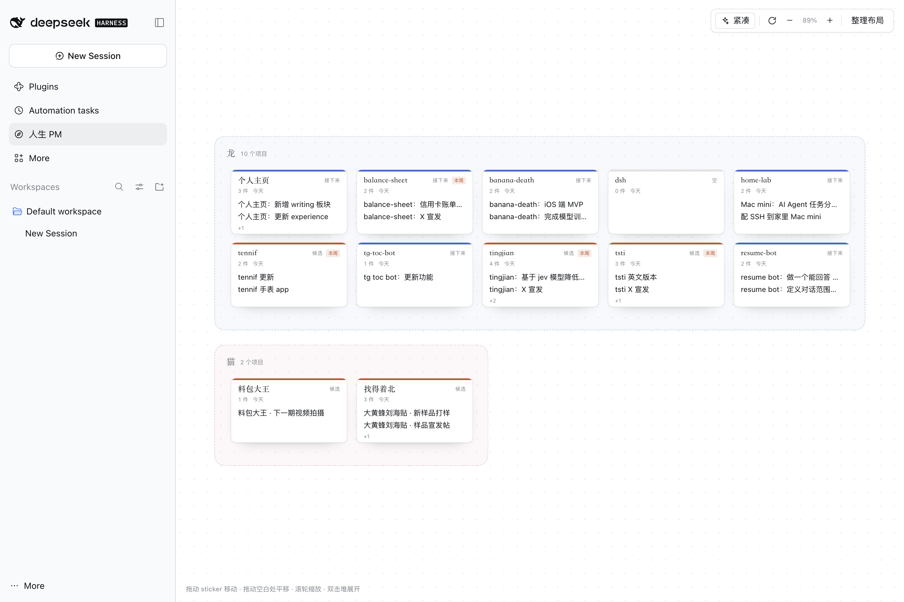
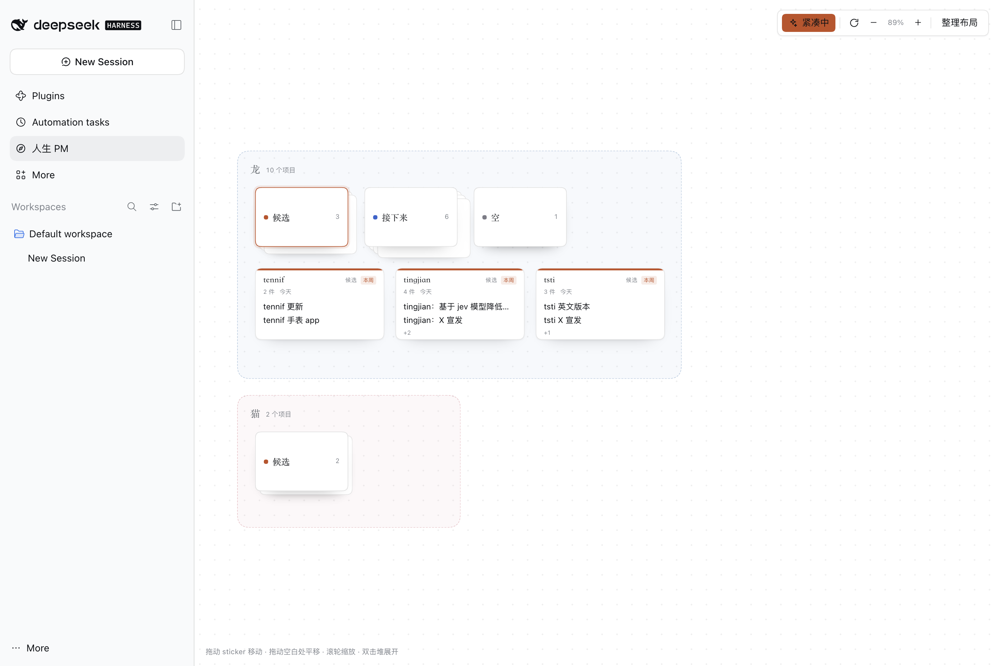

# 人生 PM · LifePM

[](https://github.com/Eric-Miao/dsh-LifePM/actions/workflows/ci.yml)

一个装在 DeepSeek Harness 里的**个人 / 家庭事项管理面板**。你们处在人生的探索期——很多事同时发生，很多事还没想清楚——所以它不逼你分类，而是先让你把脑子里的东西倒出来，再一起决定这个季度真正要押注的是什么。

数据全部是本地 Markdown，在 `life-pm/` 里，你可以直接改、备份、进 git。Agent 通过 8 个语义化工具读写同一份数据；微信 / 飞书 / Telegram 通过一个统一的收件口把消息送进来。

```
lifePM/
├── life-pm/               ← 你的看板数据（Markdown）
│   ├── pm.md              主线 · 赌注 · 我们俩 · 生活领域 · 连接器配置
│   ├── tasks/<标题>.md     每件事一个文件
│   ├── projects/<名称>.md  每条长期战线一个文件
│   ├── inbox.md           收件箱（微信 / 飞书 / TG / 快捷输入）
│   ├── journal/…          日记与决定
│   └── reviews/…          每周复盘
├── plugin/                ← 插件本体
│   ├── lib/               Host：存储 / HTTP / 连接器 / 工具
│   ├── src/client/        Web：看板界面
│   ├── bridges/           可选渠道桥接（飞书长连接、Wechaty 模板）
│   └── tests/
└── package.json           只用来装构建依赖（插件运行时零依赖）
```

## 界面

现在**只有一个页面**：全貌画布。看板、项目、日记、复盘、设置都已停用，数据仍然在 Markdown 里，agent 和渠道照常读写。



- **成员分区**：龙 / 猫，虚线边框 + 低饱和半透明底色；共同项目会多一个「我们」区。
- **项目即 sticker**：每个项目一张卡片，显示几件事、上次动过多久、前两件事。
- **拖动与吸附**：拖 sticker 移动，自动吸附 20px 网格；拖空白处平移，滚轮缩放。
- **紧凑**：按任务类型（候选 / 等待 / 接下来 / 也许）把每个人的 sticker 堆成 pile，前后错开；再点一次恢复。



- **双击 pile**：堆炸开，露出里面的项目 sticker；再双击收起。
- **点击 sticker 上的事项**：打开右侧编辑抽屉。
- **工具栏**：紧凑、适应画布、缩放、整理布局。

## 数据格式

任务文件长这样，字段就是 front matter，正文是笔记：

```markdown
---
id: t-m3k8x-9f2a
title: 预约结婚登记
status: now
priority: p1
owner: both
project: 婚礼筹备
area: relation
due: 2026-11-20
focus_week: 2026-W45
tags: [legal, 行政]
created: 2026-11-04T09:12:00+08:00
updated: 2026-11-04T09:12:00+08:00
---

民政局网站上的材料清单要提前打印。
```

- `status`：`inbox` 待整理 · `now` 现在做 · `next` 接下来 · `waiting` 等别人/等条件 · `someday` 也许 · `done` · `dropped`
- `owner`：`me` · `partner` · `both`
- `priority`：`p0`（最紧）→ `p3`
- `focus_week: 2026-W45` 表示放进「今天的三件」

改文件名没关系，`id` 才是引用依据；改标题时插件会自动重命名文件。

## 安装

以 DSH 的 `desktop` profile 为例，把仓库放在任意位置后分三步：

```bash
REPO="/absolute/path/to/LifePM"        # ← 改成你的实际路径

# 1. profile 声明依赖（解析 plugin 包用）
#    ~/.dsh/profiles/desktop/package.json → dependencies
#    "lifepm": "file:$REPO/plugin"

# 2. 让 node_modules 能解析到它
mkdir -p ~/.dsh/profiles/desktop/node_modules
ln -sfn "$REPO/plugin" ~/.dsh/profiles/desktop/node_modules/lifepm

# 3. 在 ~/.dsh/profiles/desktop/cordis.patch.yml 末尾插入 loader 行
- insert:
    - id: lifepm
      name: $REPO/plugin/lib/index.js
      config:
        dataDir: $REPO/life-pm     # 省略则默认 ~/.dsh/lifepm
        pollSeconds: 3
```

> 首次安装后**完全退出应用再打开**（⌘Q，不是关窗口）。DSH 的 profile 热加载只会更新已有行的插件；新装的包需要一次冷启动才会进入模块解析。之后改插件代码只需刷新页面。

`name` 也可以写成包名 `lifepm`（依赖已声明时，冷启动能从 profile 的 `node_modules` 解析）。`dataDir` 指向一个普通目录即可，插件会自己创建 `tasks/`、`projects/`、`inbox.md` 等文件。

## 连接器

| 渠道 | 能力 | 怎么接 |
| --- | --- | --- |
| Telegram | 收 + 发（原生） | 填 bot token 和 chat id，打开开关。插件自己长轮询，不需要公网地址 |
| 飞书 / Lark | 收 + 发（桥接脚本） | `bridges/feishu.mjs` 用官方 SDK 的 WebSocket 长连接，同样不需要公网 |
| 飞书群 / 企业微信群机器人 | 只发（每日摘要、测试） | 设置里贴 webhook |
| 微信 | 收（快捷指令 / 桥接） | 推荐 iOS 快捷指令；`bridges/wechaty.mjs` 是有风险的模板 |
| 任何东西 | 收 | `POST /lifepm/inbox?k=<token>` |

详见 [`plugin/bridges/README.md`](plugin/bridges/README.md)。

从手机访问：默认只监听 `127.0.0.1`。要在同一 Wi-Fi 下用手机发消息，把 Host 的 web server 改成 `host: 0.0.0.0`（见 DSH 的 web 配置），然后用 `http://<Mac 局域网 IP>:19387/lifepm/inbox`。只在可信网络里这么做。

## 和 Agent 一起用

对 agent 说「帮我理一下最近的事」「这周该干嘛」「记一下：……」即可。它用的是这些工具：

| 工具 | 用途 |
| --- | --- |
| `pm_board` | 读全貌 / 按状态、项目、关键词筛 |
| `pm_add` | 批量添加（标题用你的原话） |
| `pm_update` | 改状态、负责人、截止、项目，完成/放下 |
| `pm_project` | 建/改一条长期战线（为什么 + 下一步） |
| `pm_capture` | 只想倒出来、不想分类时 |
| `pm_triage` | 逐条整理收件箱：转任务 / 丢弃 |
| `pm_journal` | 记一笔，或记一个决定 |
| `pm_review` | 生成每周复盘骨架 |

`AGENTS.md` 里写了这个工作区的约定，任何会话都会遵守。

## 开发

```bash
npm install          # esbuild + react（只用于构建和测试）
npm run build        # 把 src/client 打成 DSH 的 client bundle
npm test             # 存储 / HTTP / 工具 / 界面 四组测试
```

插件运行时**没有任何第三方依赖**：Host 只用 Node 内置模块，浏览器端只 require `react`。这样它可以从任意本地路径装进 profile，不会和 DSH 的依赖图打架。

## 设计取舍

- **文件即数据库**：没有 sqlite，没有服务。你在任何编辑器里改，刷新页面就能看到；`git diff` 就是变更历史。
- **一任务一文件**：让文件系统本身就是可读的看板，也让 agent 的改动是原子的、可回滚的。
- **先捕获，后分类**：收件箱是一等公民。整理是另一件事，不应该挡住记录。
- **一个季度一个赌注**：比任务列表更重要的是「这季不做什么」。
- **连接器只有一个入口**：任何渠道最后都落到 `POST /lifepm/inbox`，格式稳定，桥接可以随时替换。

## 故障排查

- **侧边栏没有入口**：确认 `cordis.patch.yml` 里有 `lifepm` 的 `insert` 行、`node_modules/lifepm` 链接存在，然后**完全退出应用再打开**一次。
- **面板打不开 / 一直转圈**：`curl http://127.0.0.1:19387/lifepm/api/ping`，应返回 `{"ok":true,...}`。看 Host 日志里 `lifepm:` 开头的报错。
- **Telegram 不收消息**：设置里看状态点；常见原因是 token 错、没给 bot 发过 `/start`、或网络到不了 `api.telegram.org`（可用 `apiBase` 换镜像）。
- **飞书桥接报错**：确认应用已发布、事件订阅选了「长连接」、权限包含 `im:message`。
- **文件被我改坏了**：解析器很宽容，坏行会被忽略；最坏情况删掉那个文件，任务就消失了（没有回收站，建议定期 `git commit`）。

## License

MIT。见 [LICENSE](LICENSE)。
